# Order Management System

[](https://www.java.com/)
[](https://spring.io/projects/spring-boot)
[](https://maven.apache.org/)
[](#database-setup)
[](license.md)

A lightweight, extensible platform for managing day-to-day operational flows such as orders, items, inventory, clients, providers, and custom dashboards.

## Table of Contents
- [Overview](#overview)
- [Features](#features)
- [Screenshots](#screenshots)
- [Architecture](#architecture)
- [Tech Stack](#tech-stack)
- [Getting Started](#getting-started)
- [Database Setup](#database-setup)
- [Run and Build](#run-and-build)
- [API Examples](#api-examples)
- [Testing](#testing)
- [Deployment](#deployment)
- [Support](#support)
- [Contributing](#contributing)
- [Versioning](#versioning)
- [Authors](#authors)
- [License](#license)
- [Donations](#donations)

## Overview
Order Management System helps teams run core business operations from one place. It combines a JSF web UI with Spring Boot services and a relational database backend, while supporting configurable dashboards through native SQL queries.

## Features
- Manage core entities: orders, items, articles, clients, providers, and inventory.
- Use CRUD operations across all supported business entities.
- Build custom dashboard views with native SQL scripts.
- Choose between MySQL, PostgreSQL, or H2 depending on environment.
- Start quickly with built-in seed data and default credentials.

## Screenshots
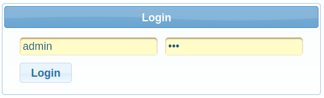
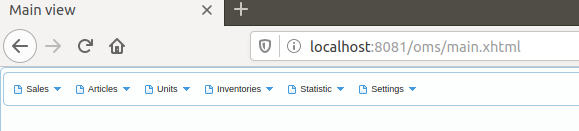
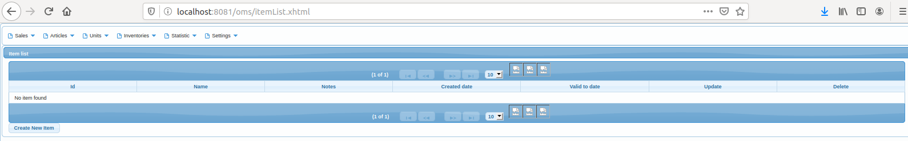
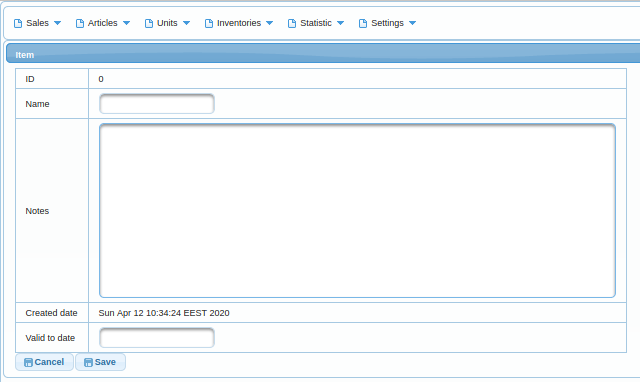
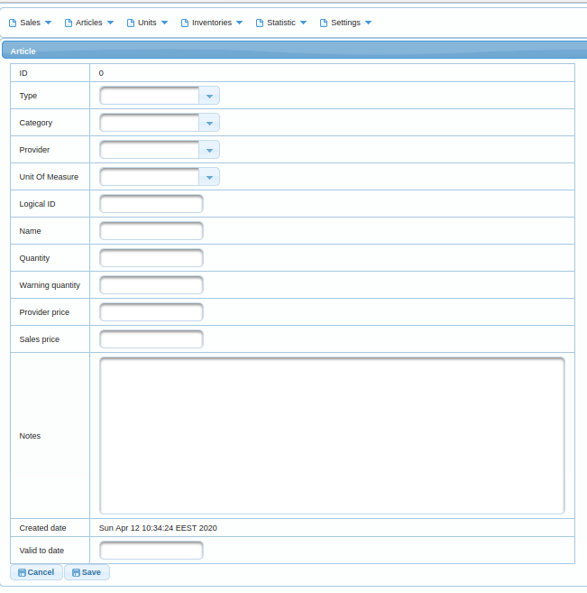
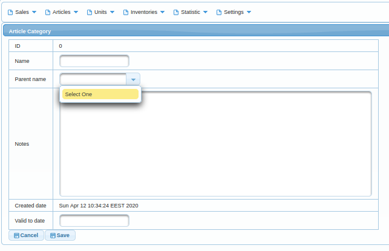
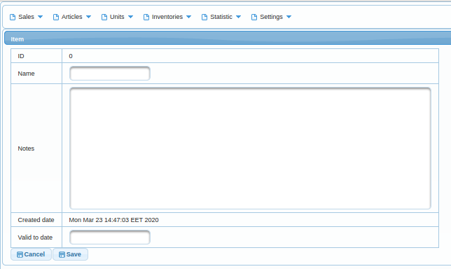
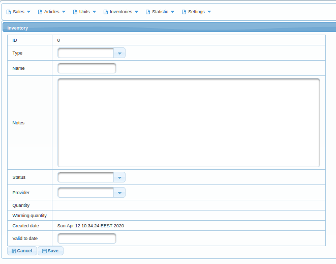
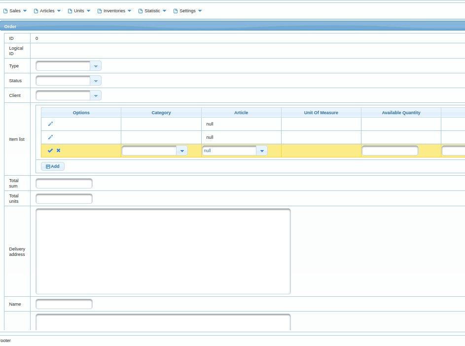
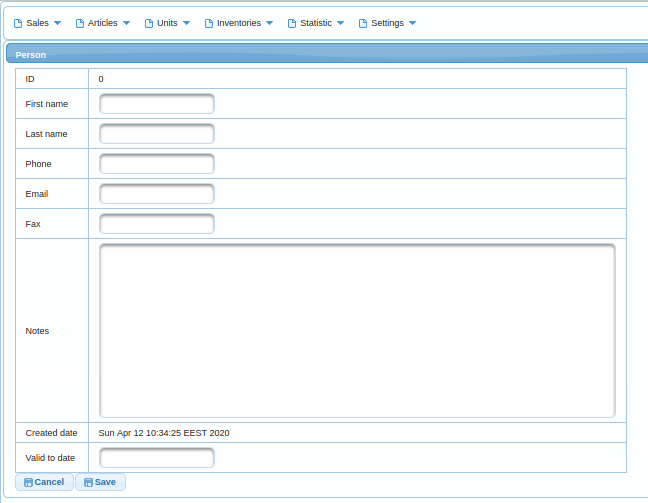
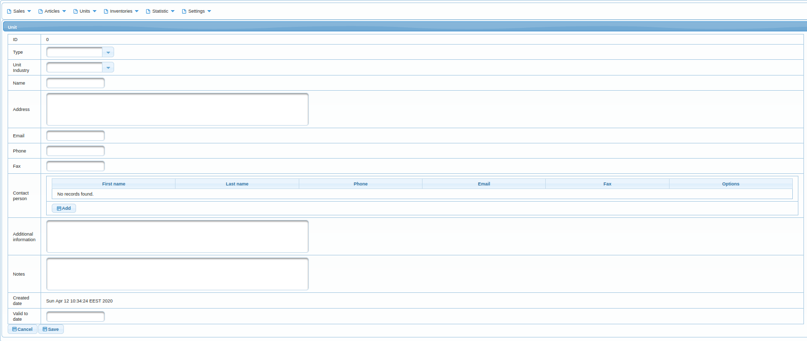
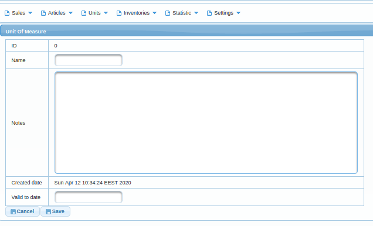
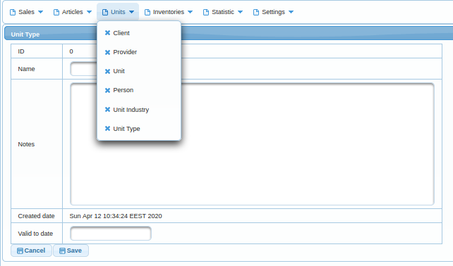

## Architecture
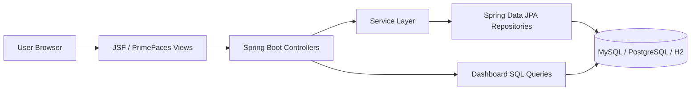

## Tech Stack
- Java 8+
- Spring Boot
- Spring Security
- Spring Data JPA
- JoinFaces + PrimeFaces
- Liquibase
- Maven
- MySQL / PostgreSQL / H2

## Getting Started
Clone the repository and configure your local environment.

```bash
git clone https://github.com/sdrahnea/order-management-system.git
cd order-management-system
git config --local user.email "your_email@domain.extension"
```

### Prerequisites
- Java 8
- Maven
- One database engine: MySQL, PostgreSQL, or H2

If you run into the Java module access error shown below, use Java 8 for this project:

```text
Unable to make field private com.sun.tools.javac.processing.JavacProcessingEnvironment$DiscoveredProcessors ...
```

## Database Setup
This project ships with Liquibase changelogs and SQL data scripts.

### SQL files often used for initial data
```text
article.sql
article_category.sql
article_type.sql
chart_type.sql
dashboard_query.sql
data.sql
first_name.sql
inventory.sql
inventory_status.sql
inventory_type.sql
last_name.sql
unit_industry.sql
unit_of_measure.sql
unit_type.sql
```

### MySQL
Create a database:

```sql
CREATE DATABASE oms;
```

For some MySQL 8 setups, you may need:

```sql
ALTER USER '${USER}'@'localhost' IDENTIFIED WITH mysql_native_password BY '${PASSWORD}';
```

### PostgreSQL
Example commands:

```bash
createuser -U postgres -s Progress
pg_restore -d DATABASE_NAME < PATH/BACKUP_FILE_NAME.sql
```

### H2
No installation required. By default, `application.properties` uses file storage mode.

## Run and Build
Build the project:

```bash
mvn clean compile package
```

Run locally:

```bash
mvn spring-boot:run
```

or run the jar:

```bash
java -jar target/order-management-system-2.0.0.jar
```

Default URL (from current configuration):
- `http://localhost:8081/oms/login.xhtml`

Default credentials:
- username: `admin`
- password: `123`

## API Examples
### Available API endpoint
User registration endpoint in `src/main/java/com/oms/controller/MainRestController.java`:

- `POST /api/user/register`

Request:

```http
POST /api/user/register
Content-Type: application/json

{
  "username": "new.user",
  "password": "StrongPassword123",
  "email": "new.user@example.com"
}
```

Response (example):

```json
{
  "id": 42,
  "username": "new.user",
  "enabled": true
}
```

### Upload API request/response example
This repository currently does not expose a dedicated upload endpoint in the REST controllers. For teams extending OMS with file import/export, the following is a compact example contract:

Request:

```http
POST /api/upload
Content-Type: multipart/form-data; boundary=----WebKitFormBoundary

------WebKitFormBoundary
Content-Disposition: form-data; name="file"; filename="inventory.xlsx"
Content-Type: application/vnd.openxmlformats-officedocument.spreadsheetml.sheet

(binary)
------WebKitFormBoundary--
```

Response (example):

```json
{
  "uploadId": "up_01JXYZABC123",
  "fileName": "inventory.xlsx",
  "status": "RECEIVED",
  "rowsDetected": 128,
  "message": "File queued for processing"
}
```

## Testing
Automated tests are currently minimal and may be absent in some modules.

Run tests with:

```bash
mvn test
```

## Deployment
After building the jar, run:

```bash
java -jar target/order-management-system-2.0.0.jar
```

When running with default properties, the app is available at:
- `http://localhost:8081/oms/login.xhtml`

## Support
If you run into an issue, open a GitHub issue or contact the maintainer using details in `license.md`.

## Contributing
Please read `CONTRIBUTING.md` for contribution guidelines and pull request process.

## Versioning
This project follows [SemVer](https://semver.org/).

## Authors
- Sergiu Drahnea - Initial work - [LinkedIn](https://www.linkedin.com/in/sergiu-drahnea-563745123)

## License
Licensed under the MIT License. See `license.md`.

## Donations
If this project helps you, donations are appreciated.

- [PayPal](https://www.paypal.me/sdrahnea)
- [EGLD](http://elrond.com/) - `erd1t3t5m8v7862asdh48nq820shsmlmuw9jpm87qw25cvch7djpkapskgq4es`
- [TROY](https://troytrade.com/) - Address: `bnb136ns6lfw4zs5hg4n85vdthaad7hq5m4gtkgf23` | Memo: `100079140`
- [PHB](https://phoenix.global/) - Address: `bnb136ns6lfw4zs5hg4n85vdthaad7hq5m4gtkgf23` | Memo: `100079140`
- [HOT](https://holochain.org/) - `0x1ebfc62e2510f0a0558568223d1d101d0cf074b2`
- [VET](https://www.vechain.org/) - `0x1ebfc62e2510f0a0558568223d1d101d0cf074b2`
- [TRX](https://tron.network/) - `TRe8xSkGqpS73Nhk6bnvW34aiJoRTmZs8N`
- [BTT](https://www.bittorrent.com/token/btt/) - `TRe8xSkGqpS73Nhk6bnvW34aiJoRTmZs8N`
